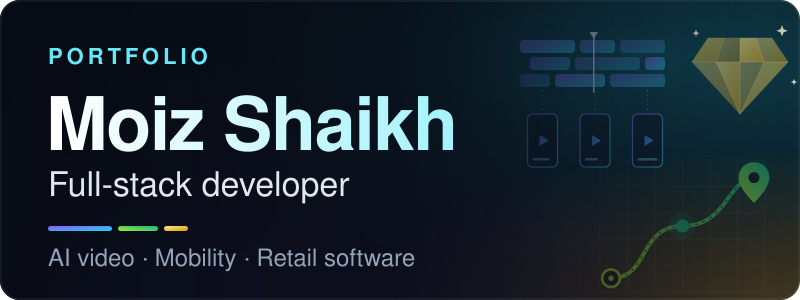
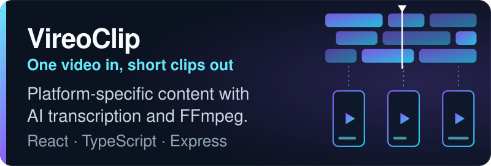
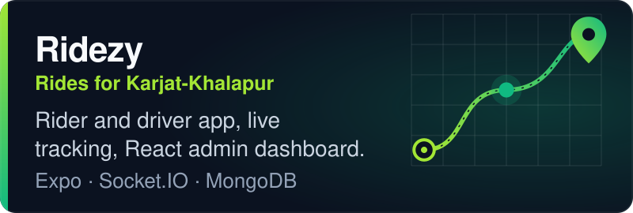
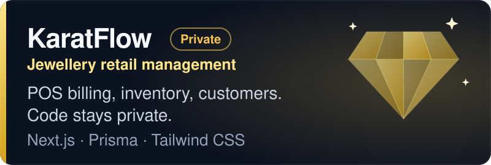
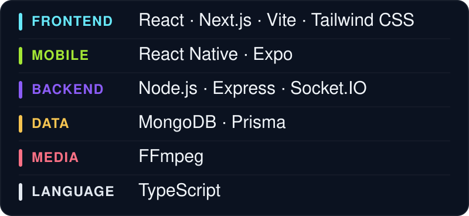

## About

I'm a full-stack developer who builds web and mobile products end to end: React and Next.js on the front, Node.js and TypeScript on the back, MongoDB and PostgreSQL for data.

Since January 2025 I have been building full-stack and AI products for real businesses at Vertex Digitals. Recent work covers AI video tooling (transcription, clipping and rendering), a ride-sharing app in React Native and retail software for jewellers.

**Open to** paid internships and part-time or full-time roles, remote included.

I also completed Stanford Online's Introduction to Internet of Things course.

## Projects

## Tech stack

